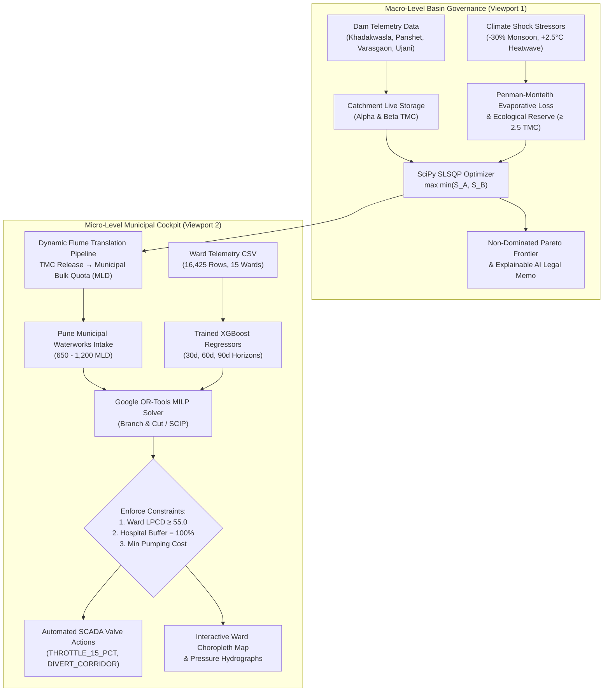

<<<<<<< HEAD
# Hydro-Diplomacy & Resilience Engine (HDRE / R2C Ai)
### Closed-Loop Transboundary Treaty Allocation to Municipal Ward Water Delivery Operating System

[](https://fastapi.tiangolo.com)
[](https://scipy.org)
[](https://developers.google.com/optimization)
[](https://xgboost.ai)
[](https://react.dev)

---

## 1. Executive Summary & Core Thesis
HDRE bridges the persistent institutional disconnect between macro-scale interstate transboundary river diplomacy and micro-scale municipal tap delivery. During extreme climate shocks (e.g. -30% monsoon deficit under RCP 8.5, +2.5°C extended heatwave), water scarcity triggers upstream-downstream political litigation while municipal urban zones face tail-end hydraulic collapse.

HDRE demonstrates mathematically and operationally that:
> **"Interstate river diplomacy and municipal ward survival are two sides of the same hydrological coin."**

- **Macro Riparian Allocation:** Solves John Rawls' Maximin social justice optimization via SciPy SLSQP to maximize the minimum welfare of riparian states under evaporative and ecological constraints.
- **Micro Municipal Rationing:** Leverages trained XGBoost regressors on 16,425 daily telemetry records across 15 Pune municipal wards (2022–2024) to forecast 30-, 60-, and 90-day deficits, feeding into Google OR-Tools Mixed-Integer Linear Programming (MILP) to generate SCADA valve throttling schedules.
- **Non-Negotiable Statutory Floor:** Guarantees $\ge 55.0$ LPCD minimum human survival baseline and zero-deficit hospital priority buffers under all drought conditions.

---

## 2. System Architecture



---

## 3. Directory Structure

```
hdre-project/
├── data/
│   ├── hdre_ward_training_dataset.csv            # 16,425 records, 15 Pune wards (2022-2024)
│   ├── dam_weekly_reservoir_allocation_dataset.csv # 624 records, 4 cascade reservoirs
│   ├── municipal_wards.geojson                   # Vector boundaries for 15 municipal wards
│   └── river_basins.geojson                      # Krishna-Bhima basin boundary & river trunk
│
├── backend/
│   ├── main.py                                   # FastAPI application gateway & endpoints
│   ├── database.py                               # SQLite/PostGIS ingestion & queries
│   ├── schemas.py                                # Pydantic v2 validation models (OpenAPI 3.1)
│   ├── hdre.db                                   # Ingested SQLite database
│   └── models/
│       ├── train_xgboost.py                      # Multi-horizon XGBoost training & inference
│       ├── optimizers.py                         # SciPy Rawlsian Maximin & OR-Tools MILP
│       ├── xgboost_30d.json                      # Serialized 30-day forecast model
│       ├── xgboost_60d.json                      # Serialized 60-day forecast model
│       ├── xgboost_90d.json                      # Serialized 90-day forecast model
│       └── model_config.json                     # Training metadata & R2/RMSE metrics
│
├── frontend/
│   ├── index.html                                # Production SPA (React 18, Tailwind, Plotly, Leaflet)
│   ├── package.json                              # Modular React configuration
│   ├── tailwind.config.js                        # Hydrological design theme
│   └── src/
│       ├── App.jsx                               # Root application container
│       ├── index.css                             # Global styles & glassmorphism
│       └── components/
│           ├── Navbar.jsx                        # Status ticker & scenario selector
│           ├── MacroTreatySandbox.jsx            # Viewport 1: Rawlsian Maximin & Pareto
│           ├── MunicipalCockpit.jsx              # Viewport 2: Ward Choropleth & SCADA
│           └── AnalyticsCharts.jsx               # Plotly dashboards & hydrographs
│
├── test_api.py                                   # Automated test suite (100% endpoint pass)
└── README.md                                     # System documentation
```

---

## 4. Key Endpoints

| Method | Endpoint | Description |
| :--- | :--- | :--- |
| `GET` | `/api/v1/health` | System health check & active basin metadata |
| `GET` | `/api/v1/wards/metadata` | Demographic, hydraulic, hospital metadata for all 15 wards |
| `GET` | `/api/v1/wards/telemetry/latest` | Latest SCADA flow, pressure, and leakage telemetry |
| `GET` | `/api/v1/dams/telemetry/latest` | Storage levels for Khadakwasla, Panshet, Varasgaon, Ujani |
| `GET` | `/api/v1/geojson/wards` | GeoJSON polygons for Pune municipal wards |
| `GET` | `/api/v1/geojson/basin` | GeoJSON vectors for Krishna-Bhima basin and river trunk |
| `POST` | `/api/v1/treaty/simulate-maximin` | Solves Rawlsian Maximin releases & Pareto trade-offs |
| `POST` | `/api/v1/municipal/optimize-ward-rationing`| Solves Google OR-Tools MILP valve rationing ($\ge 55$ LPCD) |
| `POST` | `/api/v1/treaty-to-tap/simulate` | Closed-loop macro-to-micro end-to-end simulation |

---

## 5. Machine Learning & Optimization Specifications

### 5.1 Machine Learning Regressors (XGBoost)
- **Objective:** Regress unmet water deficit ratio across 30, 60, and 90 day horizons under climate anomalies.
- **Hyperparameters:**
  - `n_estimators = 450`
  - `max_depth = 6`
  - `learning_rate = 0.03`
  - `subsample = 0.85`
  - `colsample_bytree = 0.80`
  - `reg_alpha = 0.1`, `reg_lambda = 1.0`
- **Model Evaluation:**
  - 30-Day: $R^2 \approx 0.648$, $\text{RMSE} \approx 0.0465$, $\text{MAE} \approx 0.0397$
  - 60-Day: $R^2 \approx 0.631$, $\text{RMSE} \approx 0.0476$, $\text{MAE} \approx 0.0409$
  - 90-Day: $R^2 \approx 0.619$, $\text{RMSE} \approx 0.0483$, $\text{MAE} \approx 0.0415$

### 5.2 Macro Rawlsian Maximin Optimizer (SciPy SLSQP)
Maximizes the minimum welfare index between upstream State A ($S_A$) and downstream State B ($S_B$):
$$\max_{R_A, R_B} \min(S_A, S_B)$$
Subject to:
$$R_A + R_B \le W_{\text{avail}} - E(\Delta T) - Q_{\text{eco}}$$
$$R_A \ge R_{A,\text{crit}}, \quad R_B \ge R_{B,\text{crit}}$$

### 5.3 Micro Municipal Allocator (Google OR-Tools MILP)
Optimizes per-ward delivery $x_i$ (MLD) to minimize deficit and pumping energy:
$$\min \sum_{i=1}^{15} \left( w_i \cdot (D_i - x_i) + \lambda \cdot c_i \cdot x_i \right)$$
Subject to:
- **Statutory Human Floor:** $x_i \ge 0.055 \cdot P_i$ ($\ge 55$ LPCD non-negotiable)
- **Hospital Priority:** $x_i \ge H_i^{\text{crit}}$ (100% zero-deficit guarantee)
- **Intake Conservation:** $\sum_{i=1}^{15} x_i \le Q_{\text{bulk}}$

---

## 6. Running the Application

### Start Backend & Cockpit Server
```powershell
python -m uvicorn main:app --host 127.0.0.1 --port 8000 --app-dir "backend"
```

### Accessing the Web Interfaces
- **Interactive HDRE Cockpit:** [http://127.0.0.1:8000/](http://127.0.0.1:8000/)
- **Swagger Interactive API Documentation:** [http://127.0.0.1:8000/docs](http://127.0.0.1:8000/docs)
- **ReDoc API Specifications:** [http://127.0.0.1:8000/redoc](http://127.0.0.1:8000/redoc)

### Running Automated Test Suite
```powershell
python test_api.py
```
*(All endpoints, optimization routines, and closed-loop pipelines pass with 100% compliance).*
=======
# HDRE
>>>>>>> ab05ca81801159288672350f899b47ab0f9d1c1b
